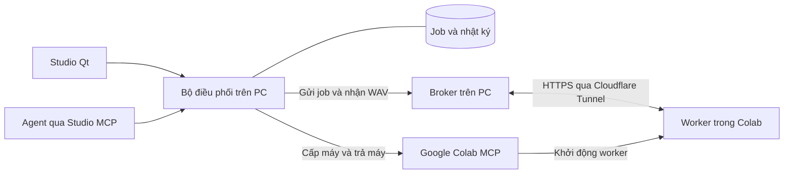

# Tự động vận hành Colab cho Colin TTS Studio

## Phương án đề xuất

Đã triển khai source tại [src/colin_colab_remote](C:/Coder/tts-voice-cloning-OMNI/src/colin_colab_remote/README.md), gồm provider, OAuth, hàng đợi chung, vòng đời runtime, remote inference và giao diện quản trị. Các đường import cũ trỏ về package mới. OAuth đã kết nối và Colab API đã bật. Pilot GPU thật chờ tài khoản có quyền lợi Colab phù hợp và số dư Compute Units.

Thêm một bộ điều phối chạy nền trên PC. Studio Qt và Colin Studio TTS MCP dùng chung bộ điều phối. Bộ điều phối gọi **Colab MCP từ xa chính thức của Google** để quản lý runtime, còn broker hiện tại chuyển job và nhận WAV qua `tts-compute.tainguyenso.online`. Người dùng cấp quyền cho một tài khoản Google lần đầu, sau đó có thể yêu cầu tạo giọng từ chat hoặc Studio. [Colab MCP từ xa](https://developers.google.com/colab/api/reference/mcp) · [Hướng dẫn broker](C:/Coder/tts-voice-cloning-OMNI/HUONG-DAN-QUAN-LY-BROKER-NEN.md)

## Mẫu lấy từ VidsVoiceQt6

- `.playwright` là nơi dò trình duyệt. Profile đăng nhập nằm riêng theo ID tài khoản dưới `%LOCALAPPDATA%/VidsVoiceQt6`. Mỗi phiên có một bên giữ quyền điều khiển, kể cả lúc người dùng mở cửa sổ đăng nhập. Xác minh danh tính trước khi chạy và sau khi bàn giao lại. Trong Studio, áp dụng nguyên tắc này cho tài khoản và phiên OAuth Colab riêng. [Dò trình duyệt](D:/_coder/VidsVoiceQt6/core.py:41) · [Profile riêng](D:/_coder/VidsVoiceQt6/accounts.py:68) · [Bàn giao đăng nhập](D:/_coder/VidsVoiceQt6/engine.py:323)
- Job có ID và nhật ký bền vững. Khi kết quả gửi chưa rõ, đối chiếu lần gửi đã ghi. Chỉ tiếp tục phần thiếu và xác minh file trước khi báo xong. Studio Qt và MCP cùng đọc trạng thái, để người dùng có thể can thiệp khi agent đang chạy. [Job VidsVoice](D:/_coder/VidsVoiceQt6/vidsvoice_mcp/jobs.py:120) · [Ghi nhận trước khi gửi](D:/_coder/VidsVoiceQt6/vids_batch.py:310)

## Tận dụng hệ thống hiện có

- Studio MCP đã nhận `runtime_target=remote` cho tạo giọng từ text và file. VieNeu v3 Turbo hỗ trợ preset, clone và CUDA. ZeroTTS 202M Official dùng CPU ở chế độ remote. Phần cần bổ sung là cấp máy, xác thực worker, theo dõi tiến độ và giải phóng máy tự động. [Hợp đồng Studio MCP](C:/Coder/tts-voice-cloning-OMNI/src/colin_studio_tts_mcp/contracts.py:78) · [Định tuyến model](C:/Coder/tts-voice-cloning-OMNI/src/omni_tts_core/service.py:1805)
- Broker có heartbeat, lease, tra job theo khóa và xác minh SHA-256 khi tải WAV. Studio MCP hiện chạy job trong tiến trình stdio và đánh dấu các job dở khi khởi động lại. Để tiếp tục khi chat đóng hoặc PC khởi động lại, cần một chủ thực thi duy nhất và lưu quan hệ giữa job, từng đoạn, broker job và runtime. [MCP job manager](C:/Coder/tts-voice-cloning-OMNI/src/colin_studio_tts_mcp/job_manager.py:49) · [Broker client](C:/Coder/tts-voice-cloning-OMNI/src/omni_tts_core/remote_compute/client.py:93)

## Trải nghiệm hằng ngày

1. Người dùng kết nối tài khoản, chọn phạm vi agent được dùng và bật quyền tự trả runtime do Studio tạo. Bản đầu dùng một tài khoản và tối đa một runtime.
2. Agent hoặc Studio gửi job. Bộ điều phối kiểm tra broker, kiểm tra quyền dùng cấu hình GPU, cấp máy khi cần, khởi động worker và đợi đúng worker báo sẵn sàng.
3. Studio hiện job, số đoạn đã xác minh, runtime/GPU, thời gian chạy và lý do chờ. Người dùng có thể tạm dừng cấp việc, hủy job, giữ máy trong thời gian cho phép hoặc giải phóng máy.
4. Bộ điều phối lưu WAV trên PC, kiểm tra kết quả rồi trả đúng runtime đã cấp theo thiết lập. Nếu xác thực hoặc hạn mức chặn bước kế tiếp, job giữ nguyên tiến độ và hiện hành động cần xử lý.

## Thứ tự triển khai

| Ưu tiên | Pha | Điều kiện hoàn tất |
| --- | --- | --- |
| 1 | [Xác minh Google MCP và quyền cấp GPU](C:/Coder/tts-voice-cloning-OMNI/plans/2026-11-09-colab-tu-dong/phase-01-xac-minh-google-mcp.md) | Đúng tài khoản, cấp và trả một GPU bằng MCP, xác nhận CUDA. |
| 2 | [Điều phối worker và job](C:/Coder/tts-voice-cloning-OMNI/plans/2026-11-09-colab-tu-dong/phase-02-dieu-phoi-job.md) | Một câu VieNeu CUDA ra WAV. Mất kết nối và mở lại client giữ đúng job và đoạn đã lưu. |
| 3 | [Giám sát và bàn giao điều khiển](C:/Coder/tts-voice-cloning-OMNI/plans/2026-11-09-colab-tu-dong/phase-03-giam-sat-va-ban-giao.md) | Tạm dừng, hủy, kết nối lại và giải phóng có phản hồi xác nhận. Studio và agent đọc cùng tiến độ. |

## Phạm vi đã xác minh

Ngày 09/11/2026, đã tạo OAuth Desktop client trong project `colin-tts-colab-2026`, bật Colab API và hoàn tất cấp quyền Google. Cấu hình và refresh token được mã hóa bằng Windows DPAPI ngoài source. Các lệnh đã xác thực `get_subscription`, `list_runtime_specs`, `list_runtimes` hoạt động. API báo `SUBSCRIPTION_TIER_FREE`; trang Settings → Subscription cũng chưa có quyền lợi trả phí. Lượt thử cấp CPU trả `Precondition check failed.`; đã đối soát xóa đúng máy thử và danh sách runtime cuối cùng trống. Chưa chạy worker GPU hoặc tạo WAV thật qua luồng tự cấp máy.

Đối chiếu tiếp trên đúng tài khoản: Google One có gói **Google AI Pro (5 TB)**, phần quản lý ghi **Offered through Jio**. Trang Benefits hiển thị kỳ **Google AI Pro trial**; Colab → View resources ghi **You are not subscribed**. Nhãn Free của Colab không phủ nhận gói AI Pro đang tồn tại. Google xác nhận 200 Colab Compute Units cho AI Pro đủ điều kiện nhưng loại trừ kỳ dùng thử, gồm chương trình ưu đãi hoặc dùng thử kéo dài. Đây là nguyên nhân phù hợp với các trạng thái đã quan sát; chưa có bằng chứng tài khoản được cấp 200 Compute Units. [Quyền lợi AI Pro](https://support.google.com/googleone/answer/14534406?hl=en) · [Điều kiện kỳ dùng thử](https://research.google.com/colaboratory/faq.html) · [Ưu đãi Jio](https://www.jio.com/google-gemini-offer/)

Broker công khai báo `managed_colab=enabled`. Ghép managed worker, duyệt phiên và tải gói source có SHA-256 đã được kiểm tra riêng. Để hoàn tất pilot, cần xác nhận tài khoản có quyền lợi Colab phù hợp cùng số dư Compute Units, sau đó cấp GPU, chạy một câu VieNeu, tải WAV và xác nhận trả runtime. Giữ quy trình notebook ghép mã để vận hành tay. Nếu MCP của Google không dùng được với tài khoản đã chọn, có thể thử CLI chính thức trên Ubuntu WSL2 đã có trên máy. CLI hỗ trợ Linux và macOS. [Danh sách công cụ Colab MCP](https://developers.google.com/colab/api/reference/mcp) · [Colab CLI](https://github.com/googlecolab/google-colab-cli)

## Quyết định còn mở

- Chọn cấu hình GPU đủ cho VieNeu v3 sau khi đo warm-up, bộ nhớ và thời gian tạo mẫu. Pilot giữ một runtime và trả khi hết hàng đợi.
- Chốt trần thời gian và phạm vi đầu ra lúc người dùng bật chế độ tự động. Giữ ấm và thêm model sau khi có số đo thực tế.
