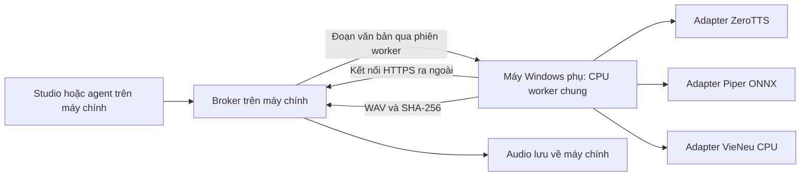

# CPU từ xa dùng chung cho các provider TTS

Ngày 09/11/2026. Broker và bộ cài đã phát hành, chờ ghép CAROPC và ColinThinkPad. Xem [biên bản kiểm tra](C:/Coder/tts-voice-cloning-OMNI/plans/2026-11-09-zerotts-may-cpu-tu-xa/implementation-log.md).

## Mục tiêu và quyết định

Người dùng chọn máy Windows kết nối qua Internet và yêu cầu một đường CPU chung cho ZeroTTS, Piper ONNX, VieNeu và các model CPU được bổ sung sau. Máy chính giữ Studio/MCP và broker; máy phụ có một host worker điều phối adapter từng provider. Tái sử dụng `https://tts-compute.tainguyenso.online`. Job PC độc lập với API/quyền Google. Health PC và HTTPS đã được kiểm tra `status=ok` ở lượt khảo sát trước; không phải bằng chứng đã có worker PC chạy thật.

Xây dispatcher, capability registry và đường gửi job chung ngay từ đầu; **ZeroTTS 202M Official ONNX** là adapter thử đầu tiên. Sau đó thêm Piper ONNX và VieNeu v3 Turbo 3.6.4 CPU FP32. VieNeu cũ, GGUF hoặc provider khác chỉ được chạy khi có adapter đúng model/backend. Giữ một model active và một job trên mỗi máy tại một thời điểm; đo máy thật trước khi chốt số luồng.

## Quy trình cho người dùng

1. Cài host worker Windows một lần; chuẩn bị các module/model được chọn, ban đầu là ZeroTTS. Mỗi engine có môi trường riêng và tải đúng phiên bản.
2. Duyệt mã ghép máy trên máy chính, kiểm tra tên máy, CPU và danh sách model được cấp quyền. Máy phụ giữ quyền thiết bị bằng Windows DPAPI.
3. Chọn provider/model như hiện tại; tại **Thiết bị xử lý** chọn **CPU máy khác**, rồi chọn máy Windows đã ghép. Đổi provider vẫn dùng cùng kết nối, hàng đợi và giao diện quản trị. Agent/MCP dùng cùng lựa chọn.
4. Worker nhận từng đoạn, tạo WAV và gửi về. Studio hiển thị trạng thái máy, tiến độ, thời gian và lỗi; phần đã xác minh được lưu.
5. Người dùng có thể tạm dừng job, hủy job, ngừng nhận việc hoặc dừng worker; vẫn có bảng Start/Stop/Status/Logs tại máy phụ.

Đóng bảng quản lý không dừng worker. Khởi động cùng Windows là tùy chọn lúc đăng nhập. Máy chính phải bật để broker hoạt động; máy phụ phải bật, có Internet và không ngủ khi xử lý. Dừng worker không tắt Windows. Khởi chạy lại một worker đã dừng cần bộ giám sát còn hoạt động; nếu bộ giám sát cũng dừng thì dùng launcher trên máy phụ hoặc kênh quản trị máy đã được cấp quyền.

## Phần đã có và phần cần bổ sung

| Đã có | Cần bổ sung cho PC |
|---|---|
| ZeroTTS CPU, handler VieNeu v3 CPU, Piper local, heartbeat/lease | Host dispatcher, adapter Piper, môi trường riêng, probe và quản lý model active |
| Broker HTTPS, mã ghép Colab, quyền worker giới hạn | ID máy PC, ghép thiết bị, quyền có thể làm mới và thu hồi riêng từng máy |
| Router remote hai model, profile worker, xác minh WAV/hash | Router/capability chung theo model và CPU; PC không đi Google lifecycle |
| Job store và pause/cancel trong supervisor Colab | Lõi hàng đợi chung, lifecycle PC riêng, điều khiển nhận việc và bảng máy phụ |

## Tổ chức source

- Repository `D:/_coder/colin-tts-compute-service` sở hữu host worker/bộ cài; `pc_worker/` chứa cấu hình, supervisor, dispatcher và registry adapter; `adapters/` giữ lớp nối từng engine. `colab/` chứa bootstrap/notebook Google.
- Chuẩn hóa dần phần dùng chung của Studio thành `src/colin_remote_compute/` cho broker, queue/context, inference và profile đích. `src/colin_colab_remote/` giữ OAuth, Google adapter và lifecycle Colab. Chuyển từng nhóm nhỏ, giữ alias import và dữ liệu cũ; không sao chép supervisor/hàng đợi.
- Máy phụ nhận gói phát hành worker có manifest/hash; không cần cài toàn bộ Qt Studio. Runtime, quyền, model, cache và log ở ngoài source. Chỉ cập nhật lúc worker rảnh, có thể quay lại bản trước.

## Pha triển khai

| Pha | Trạng thái | Điều kiện hoàn tất |
|---|---|---|
| [1. Gói worker Windows](C:/Coder/tts-voice-cloning-OMNI/plans/2026-11-09-zerotts-may-cpu-tu-xa/phase-01-worker-windows.md) | Đã đóng gói và thử trên Windows | Máy phụ nạp đúng model, tự kiểm tra WAV, có launcher và trạng thái |
| [2. Điều phối và ghép máy](C:/Coder/tts-voice-cloning-OMNI/plans/2026-11-09-zerotts-may-cpu-tu-xa/phase-02-dieu-phoi-va-ghep-may.md) | Đã bật trên broker | PC có quyền riêng, điều khiển hai phía và dùng chung job store |
| [3. Thử thật và đo CPU](C:/Coder/tts-voice-cloning-OMNI/plans/2026-11-09-zerotts-may-cpu-tu-xa/phase-03-pilot.md) | Đã thử trên một máy Windows, chờ hai máy đích | Từ máy chính nhận WAV thật, thử điều khiển, nối lại mạng và thu hồi quyền |
| [4. Adapter Piper và VieNeu](C:/Coder/tts-voice-cloning-OMNI/plans/2026-11-09-zerotts-may-cpu-tu-xa/phase-04-adapter-cpu-dung-chung.md) | Đã chạy WAV qua Studio | Cùng worker/profile chạy ZeroTTS, ba model Piper và VieNeu v3 với đúng sample rate |

Hợp đồng chung ở pha 4 là yêu cầu thiết kế ngay từ pha 1; thứ tự bật provider là ZeroTTS → Piper → VieNeu v3. Máy công bố model đã cài, model có thể nạp và model đang sẵn sàng riêng biệt. Higgs Remote GPU là endpoint riêng, không thuộc đường CPU chỉ nhờ có nhãn remote.

## Bằng chứng và câu hỏi còn mở

[Runtime ZeroTTS](C:/Coder/tts-voice-cloning-OMNI/plans/2026-11-09-zerotts-may-cpu-tu-xa/reports/zerotts-runtime.md) · [Điều khiển PC](C:/Coder/tts-voice-cloning-OMNI/plans/2026-11-09-zerotts-may-cpu-tu-xa/reports/pc-worker-control.md) · [Adapter nhiều provider](C:/Coder/tts-voice-cloning-OMNI/plans/2026-11-09-zerotts-may-cpu-tu-xa/reports/cpu-provider-adapters.md) · [UI và hợp đồng đích CPU](C:/Coder/tts-voice-cloning-OMNI/plans/2026-11-09-zerotts-may-cpu-tu-xa/reports/cpu-target-ui-contract.md).

Hai máy đích là CAROPC và ColinThinkPad. Chờ chạy bộ cài và ghép từng máy để kiểm tra cấu hình thật, kết nối Internet và đo tốc độ. Bộ cài kiểm tra Windows x64 và chuẩn bị Python 3.12 cho worker.
