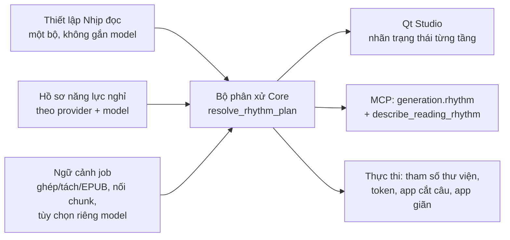

# Nhịp đọc: một bộ thiết lập ngắt nghỉ, áp theo năng lực từng model

Ngày 10/11/2026. Trạng thái: **đã triển khai pha 0–4** (chưa commit, chưa nghe thử bằng tai, chưa chạy job EPUB/tách thật). Xem từng file pha.

## Vấn đề

Hiện có 5 chỗ cùng điều khiển khoảng nghỉ, mỗi chỗ một kiểu đơn vị, và chồng lên nhau:

| Chỗ | Tác động | File |
|---|---|---|
| Ngắt nghỉ theo dấu câu (Min–Max) | App cắt câu tại `. , ; : …`, chèn lặng **thêm** | `src/omni_tts_core/text/punctuation_pauses.py`, `pause_presets.py` |
| Nghỉ giữa đoạn gốc (Min–Max) | Chèn lặng **thêm** giữa đoạn | `service.py` `_paragraph_pause_values` |
| Nối chunk (Auto/lặng/crossfade/nối thẳng) | Lặng kỹ thuật giữa mẩu | `chunk_join.py` |
| Tinh chỉnh riêng provider | ZeroTTS `segment_gap_seconds`, Supertonic/VieNeu silence… | `provider_registry.py` settings |
| Nhịp kể chuyện | Giãn tới **tổng** lặng mục tiêu, sau khi ghép | `narrative_pacing/` |

Model mỗi loại xử lý nghỉ khác nhau (đã khảo sát 10/11/2026):

- Chỉ **Kokoro** nhận tham số nghỉ theo từng dấu câu (`sentence_pause`, `clause_pause`, tính tổng lặng). App đang đặt 0 rồi tự cắt (`engines/kokoro_worker/synthesize.py:106`).
- **Supertonic** (`silence_duration`) và **VieNeu v2** (`silence_p`) chỉ chèn lặng giữa mẩu nội bộ của thư viện.
- **VieNeu v3 Turbo** dùng mức cố định 0,3/0,5/0,7s, không chỉnh được.
- **OmniVoice** mặc định rút lặng dài hơn 0,5s trong mỗi mẩu về tối đa khoảng 1s (`postprocess_output`, bản 0.2.1).
- **Higgs** nhận token `pause`/`long_pause` viết trong văn bản.
- Các model còn lại không có tham số nghỉ.

Người dùng không biết số nào đang có hiệu lực với model đang chọn.

## Mục tiêu

1. Gom thành một mục **Nhịp đọc**, dùng chung cho mọi provider. Mỗi tầng nghỉ đặt bằng **Min–Max, tính theo tổng lặng nghe thấy**.
2. Đổi model **không bao giờ đổi con số**. Chỉ đổi **ai thực hiện** từng tầng, và giao diện ghi rõ việc đó.
3. Mỗi tầng chỉ có **một bên đảm nhận**, không cộng dồn giữa model và app.
4. Qt Studio và MCP đọc cùng một kết quả phân xử do Core tính.
5. Khi tắt Nhịp đọc, mọi thứ chạy **y như hiện nay**.

## Kiến trúc

### Các tầng

| Nhóm | Tầng (`layer_id`) | Nguồn giá trị hiện tại |
|---|---|---|
| Trong câu | `comma`, `clause` (`; :`), `ellipsis` | punctuation_pauses + `comma_min_pause_ms`, `colon_pause_ms` |
| Cuối câu | `sentence_end` (`. !`), `question_end`, `short_sentence` | punctuation `sentence_*` + pacing `sentence_end/question_end/short_sentence` |
| Giữa đoạn | `connector`, `paragraph`, `question`, `emphasis`, `subtopic`, `section` | `paragraph_pause_*` + pacing tiers |
| Nhạc | `music_theme`, `music_short`, `music_long` | `NarrativeMusicOptions` (giữ nguyên) |
| Kỹ thuật | `chunk_seam` (chỉ hiển thị, không chỉnh trong Nhịp đọc) | `chunk_join_mode` |

### Cách thực hiện (`mechanism`) và nhãn hiển thị

| mechanism | Nghĩa | Nhãn |
|---|---|---|
| `native_token` | Chèn token nghỉ vào văn bản (Higgs) | 🟢 MODEL |
| `library_param` | Truyền đúng con số vào tham số thư viện (Kokoro) | 🟢 MODEL |
| `app_split` | App cắt tại dấu câu, đọc từng phần, chèn lặng tới tổng | 🔵 APP |
| `app_stretch` | Đọc liền, app giãn lặng có sẵn tới tổng sau khi ghép | 🔵 APP |
| `library_fixed` + `app_stretch` | Model có mức riêng không chỉnh được, app chỉ bù phần thiếu | 🟡 MODEL TỰ LO + APP BÙ |
| có `limit` | Làm được một phần (rút lặng, đọc liền dấu phẩy, crossfade, đổi dấu) | 🟠 GIỚI HẠN |
| `not_applicable` | Chế độ xuất hiện tại không dùng tầng này | ⚪ KHÔNG ÁP DỤNG |

Thứ tự chọn bên đảm nhận: `native_token` → `library_param` → `app_split` → `app_stretch`. Tầng đã có bên đảm nhận thì mọi cách khác **tắt cho tầng đó**.

## Các pha

| Pha | Nội dung | Điều kiện xong |
|---|---|---|
| [0. Đo năng lực thật](phase-00-do-nang-luc.md) — **đã đo model CPU, chờ GPU nguội để đo model GPU** | Script đo lặng tại từng dấu câu cho mọi model đang cài | Bảng số đo thay cho các giả định trong hồ sơ |
| [1. Hồ sơ năng lực + bộ phân xử](phase-01-ho-so-va-bo-phan-xu.md) — **đã làm lõi** | `rhythm/`, `resolve_rhythm_plan`, test ma trận | Ma trận provider × tầng × chế độ khớp bảng mẫu |
| [2. Thiết lập hợp nhất + chuyển đổi](phase-02-thiet-lap-hop-nhat.md) — **đã làm Core** | `ReadingRhythmOptions`, chuyển từ cài đặt cũ, preset | Bật/tắt không làm mất cài đặt cũ |
| [3. Thực thi theo bên đảm nhận](phase-03-thuc-thi.md) — **đã làm** | Service + worker đọc kết quả phân xử | Không tầng nào bị áp hai lần, số đo đạt mục tiêu |
| [4. Giao diện Qt, MCP, tài liệu](phase-04-giao-dien-mcp.md) — **đã làm** | Mục Nhịp đọc trong Qt, khóa mục cũ, báo khác biệt khi đổi model, MCP đầy đủ | Đổi model thấy rõ tầng nào đổi trạng thái; MCP trả cùng kết quả |

Pha 0 và 1 làm song song được. Pha 3 cần pha 1 và 2. Pha 4 cần pha 1; phần khóa mục cũ cần pha 2.

## Ràng buộc

- Không động vào phần Colab/remote đang dở (`contracts.py`, `server.py`, `pyproject.toml` có thay đổi chưa commit của việc khác). Khi sửa `contracts.py`/`server.py` chỉ thêm trường mới, không sắp xếp lại import.
- Worker remote CPU (`colin_remote_compute/piper.py`, ZeroTTS remote) phải nhận cùng tham số. Nếu không, phân xử phải hạ nhãn xuống APP cho thiết bị remote.
- Không đổi kết quả audio khi Nhịp đọc tắt: test so sánh hash/thời lượng với job hiện tại.

## Quyết định đã chốt (10/11/2026)

1. **OmniVoice:** có tùy chọn "Giữ khoảng lặng dài (tắt rút lặng của OmniVoice)". **Mặc định bật** khi Nhịp đọc bật, tức là truyền `postprocess_output=False`. App tự cắt lặng bất thường >2s trước bước giãn. Khi người dùng tắt tùy chọn: thư viện rút lặng như cũ, các tầng trong câu/cuối câu mang nhãn GIỚI HẠN.
2. **Kokoro:** có tùy chọn "Cách ngắt nghỉ của Kokoro":
   - *Tham số model* (mặc định): đọc liền mạch, mỗi loại dấu một giá trị (điểm giữa Min–Max), nhãn MODEL.
   - *App cắt câu*: có dao động Min–Max theo từng lần xuất hiện, nhãn APP.
3. **EPUB dùng Nhịp đọc:**
   - Các tầng trong câu, cuối câu và giữa đoạn áp vào đoạn văn trong chương.
   - Ranh giới tên quyển/tên chương/chương/cảnh vẫn do EPUB quản lý (`title/chapter/scene/volume_pause_ms` và nhạc chương). Tầng `section` và nhạc của Nhịp đọc là KHÔNG ÁP DỤNG với EPUB.
   - SRT và mốc chương của EPUB được dịch theo timeline mới.
4. **Giao diện:** chỉ làm Qt Studio (giao diện đang dùng). Tkinter/Gradio không đổi; request từ đó vẫn chạy vì Nhịp đọc mặc định tắt.
5. **MCP cập nhật đầy đủ:**
   - Hợp đồng `generation.pacing` (TXT và EPUB) và `get_generation_contract`.
   - Tool mới `describe_reading_rhythm`.
   - `plan_narrative_pacing` và `pace_existing_audio`.

Tùy chọn riêng theo model (1, 2) khai báo trong hồ sơ năng lực dưới dạng `RhythmSwitch`, không viết cứng theo provider trong giao diện.
